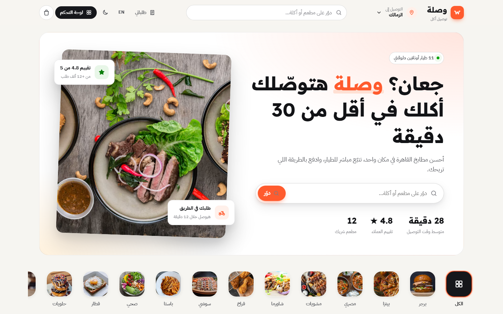
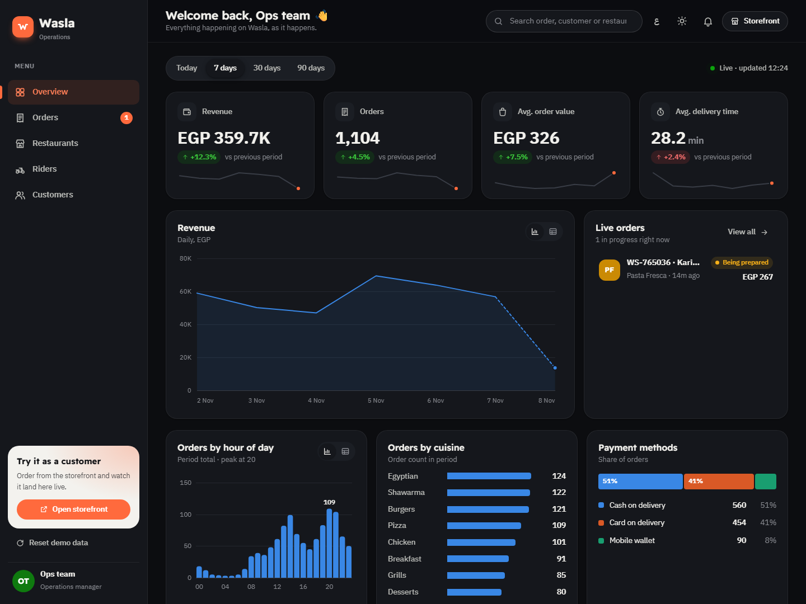
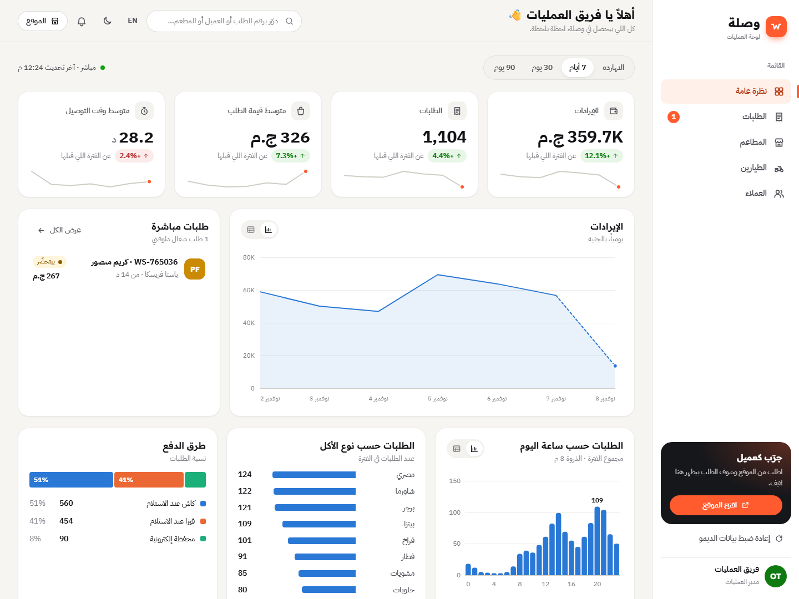
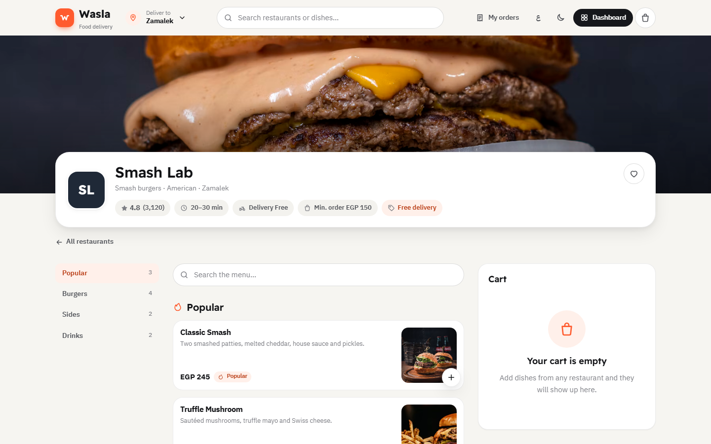
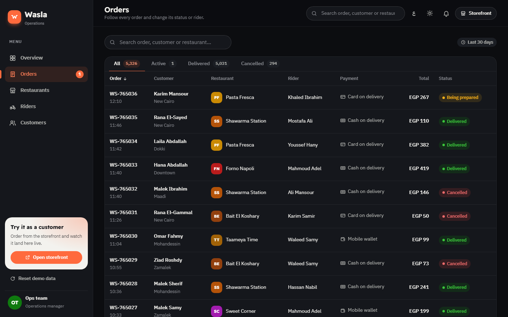
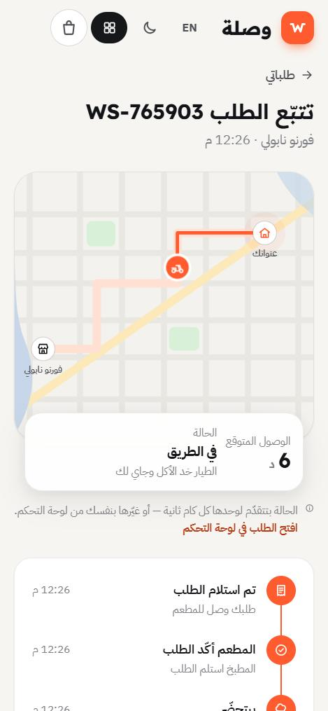
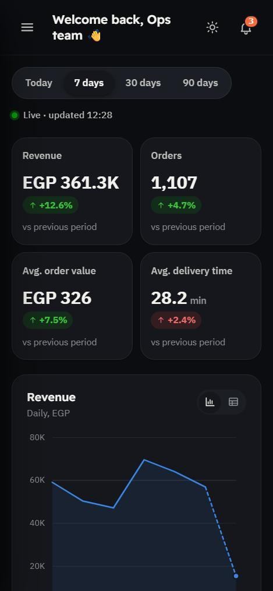

# Wasla · وصلة — food delivery + operations dashboard

A complete food-delivery web app with **two sides that talk to each other**:

- **Storefront**: browse restaurants, customise dishes, check out, and **track your rider live on a map**.
- **Operations dashboard**: KPIs, charts, a live order feed, and order management. Ops can move an order through its stages, cancel it, reassign the rider, or pause a restaurant.

Place an order on the storefront and it shows up **instantly** on the dashboard, even in another browser tab. Change its status on the dashboard and the customer's tracking page updates live.

**Live demo:** https://aametwally400-cloud.github.io/wasla-delivery/ · [Dashboard](https://aametwally400-cloud.github.io/wasla-delivery/#/admin) · [English version](https://aametwally400-cloud.github.io/wasla-delivery/?lang=en) · [العربية](#بالعربي)



| Dashboard (English, dark) | Dashboard (Arabic, light) |
| --- | --- |
|  |  |
| **Restaurant page** | **Orders management** |
|  |  |

<p align="center">
  
  &nbsp;&nbsp;
  
</p>

---

## Highlights

**Product**
- 12 restaurants, ~80 dishes with option groups (sizes, extras, crusts, milk…), special instructions, and quantity.
- Cart with a minimum-order check, delivery and service fees, and promo codes (try `WASLA20`). Starting a cart at a second restaurant asks before replacing the first.
- Checkout validates Egyptian mobile numbers and offers ASAP or a scheduled time plus cash, card or wallet payment.
- Live tracking: an animated rider moves along the route, with an ETA countdown, a status timeline, a rider card, confetti on delivery, and a rating at the end.
- Dashboard ranges (today / 7 / 30 / 90 days) drive everything below them: KPI tiles with deltas and sparklines, a revenue trend, orders by hour, cuisine mix, payment split, top restaurants, and the live feed.
- Orders table with status tabs, search, sorting and pagination. A side drawer moves an order to its next stage, cancels it, or assigns a rider.
- Restaurant pause/resume closes ordering on the storefront immediately. The Riders page shows who is available, busy or offline. The Customers page has VIP, Regular and New segments.

**Engineering**
- **Zero dependencies, no build step**: vanilla JavaScript ES modules, hand-written CSS and SVG charts.
- **Bilingual and RTL-first**: Arabic (Egyptian) and English. The layout flips cleanly using CSS logical properties.
- **Light and dark themes** with separately tuned tokens (not an automatic inversion), following the OS setting until the user picks one.
- **Realistic simulated data**: ~180 days of history (~30k orders) from a seeded PRNG, with lunch and dinner peaks, weekend bumps and growth. It is regenerated identically on every load, so nothing heavy is stored.
- **State**: a small pub/sub store persisted to `localStorage` and synced across tabs with the `storage` event.
- **Accessible**: semantic HTML, keyboard support everywhere (focus traps in dialogs, arrow keys on charts), visible focus rings, `aria-live` regions, `prefers-reduced-motion`, and a table view for every chart.
- **Charts follow one spec**: hairline grids, 2px lines, ≤24px bars with rounded data ends, a snapping crosshair tooltip, and colour-blind-safe series colours (validated in both themes).
- **Responsive** from 360px phones to wide desktops. Data tables turn into cards on small screens.

## Run it locally

Any static server works, because ES modules can't load from `file://`.

```bash
python -m http.server 5173
```

Then open <http://localhost:5173>. Add `?lang=en` or `?theme=dark` to the URL to switch language or theme.

## Project structure

```
index.html            entry (pre-paint theme + language, no flash)
css/
  base.css            design tokens (light + dark), reset, typography
  components.css      buttons, fields, badges, modal/drawer, toasts, tables, charts
  store.css           storefront pages
  admin.css           dashboard pages
js/
  app.js              hash router, layout shells, simulation clock
  store.js            state, persistence, cross-tab sync, cart maths
  ops.js              order engine: seeded history, live simulation, analytics
  data.js             restaurants, menus, option groups, riders
  i18n.js             Arabic + English strings and formatters
  charts.js           SVG area / column charts and sparklines
  ui.js               toasts, dialogs, images with graceful fallback
  views/              one module per page
```

## Credits

- Food photography from [Unsplash](https://unsplash.com) (Unsplash License), hot-linked.
- Fonts: [IBM Plex Sans Arabic](https://fonts.google.com/specimen/IBM+Plex+Sans+Arabic) and [Readex Pro](https://fonts.google.com/specimen/Readex+Pro) (SIL Open Font License).
- Restaurant, rider and customer names are fictional. No real payments or personal data are involved.

---

## بالعربي

**جرّب الموقع:** https://aametwally400-cloud.github.io/wasla-delivery/

**وصلة** موقع توصيل أكل متكامل، ومعاه لوحة تحكم للعمليات. الجزءين مربوطين ببعض:

- **الموقع**: تتصفّح المطاعم، تختار الأكلة والإضافات، تكمّل الطلب، وتتابع الطيار وهو جاي لك على الخريطة لايف.
- **لوحة التحكم**: إيرادات، عدد الطلبات، رسوم بيانية، طلبات مباشرة، وإدارة كاملة للطلبات والمطاعم والطيارين والعملاء.

اطلب من الموقع وهتلاقي الطلب ظهر في لوحة التحكم على طول، حتى لو فاتحها في تاب تاني. غيّر حالة الطلب من اللوحة وصفحة التتبّع عند العميل تتحدّث لوحدها.

معمول بـ JavaScript و CSS من غير أي مكتبات ومن غير build. بيدعم العربي والإنجليزي، والوضع الفاتح والداكن، وشغال على الموبايل.

## License

[MIT](LICENSE)
